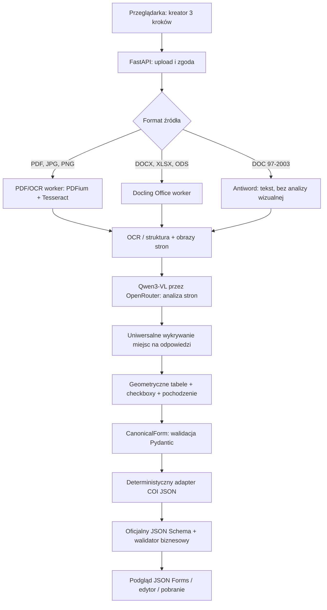

# FormFlow AI — architektura aktualnej wersji (21.11.2026)

> **Status:** działający prototyp COI. Qwen3-VL działa przez **OpenRouter**,
> więc wersja nie spełnia konkursowego zakazu zewnętrznych API.
> Pełny test importu w oficjalnym systemie COI nie został potwierdzony.
> Aktualne zadania: [TASKLIST.md](TASKLIST.md).

## Przepływ danych

*OCR i detekcja formatów są lokalne.* W trybie konwersji z OpenRouter
teksty/obrazy źródłowe są przekazywane do usługi zewnętrznej **dopiero po
świadomej zgodzie**. Demo syntetyczne i podgląd samego OCR nie wysyłają
zawartości do zewnętrznego modelu.

## Warstwy i kontrakty

1. **Upload** (`uploads.py`) weryfikuje rozszerzenie, podstawową sygnaturę
   pliku, limit rozmiaru i dla OOXML/ODS strukturę ZIP.
2. **Extraction Router** (`extraction_router.py`) łączy wyłącznie z prywatnymi
   adresami Docker. Format DOC jest odczytywany przez osobny proces Antiword
   w izolowanym workerze; ma status **text_only** i wymaga kontroli układu.
3. **Ekstrakcja semantyczna** (`structured_extraction.py`) analizuje strony
   osobno i korzysta z niezmiennych opisów miejsc w źródle. Moduły
   `layout_slots.py`, `visual_tables.py` oraz `visual_choices.py`
   wspomagają rozpoznawanie tabel i opcji, bez szablonów dokumentów.
4. **CanonicalForm** (`canonical_form.py`) to ściśle typowany model pośredni:
   `pages → sections → fields`, `required`, `options`, `row/column`,
   `evidence/source_page` i `show_when`. Waliduje dane bez domyślania pól.
5. **Eksport COI** (`coi_builder.py`) tworzy `tabs/questions/flow`,
   identyfikatory UUID5 i bezpieczne warunki SHOW. Walidator
   `coi_validation.py` korzysta z oryginalnego schematu COI, który
   jest liberalny; poprawny JSON nie gwarantuje importowalności.
6. **Podgląd React + JSON Forms** jest osobną reprezentacją pochodną,
   nie zastępuje wyniku COI JSON. Edycje definicji pozostają w pamięci
   przeglądarki do chwili pobrania pliku.

## Deployment i bezpieczeństwo

- `compose.yaml` uruchamia API na `127.0.0.1:18171`.
- Nakładki `compose.dev.yaml`, `compose.docling.yaml`,
  `compose.pdf.yaml` włączają API modelu i izolowane workery.
- Workery mają prywatną sieć Docker, brak publicznego portu,
  ograniczenia pamięci, proces bez root, pliki tymczasowe na tmpfs.
- Tailscale Serve pod adresem `https://vibe.tail075c6f.ts.net:9466/`
  udostępnia kreator członkom autoryzowanego Tailnetu.
- Logi konwersji w `data/private/logs` zawierają metadane i identyfikatory
  żądań, bez surowych tekstów/payloadów dokumentów.
- Frontend JSON Forms/Ajv korzysta jeszcze z wyjątku CSP `unsafe-eval`;
  dla produkcji wymagane wydzielenie renderera.
- JWT, audyt zależności i wiarygodność konwersji wszystkich formatów
  pozostają zadaniami otwartymi.

## Testy i ograniczenia

- Backend: **101 testów zaliczonych** po dodaniu CanonicalForm i DOC.
- Frontend: **16 testów zaliczonych**; build poprawny.
- Prawdziwy plik binarny Word 97–2003 przeszedł `/extract` workera i
  `/api/v1/forms/extract-preview` z HTTP 200.
- Dalsza praca: wizualne odtworzenie układów Office/DOC, integracja importera
  COI, rozszerzenie słowników, security i komplet materiałów konkursowych.
- Licencje: [THIRD_PARTY_LICENSES.md](../THIRD_PARTY_LICENSES.md).
  Antiword jest GPL i wymaga osobnej oceny dystrybucyjnej.
- Regulaminowa decyzja o API:
  [DECISION_API_SUBMISSION.md](DECISION_API_SUBMISSION.md).