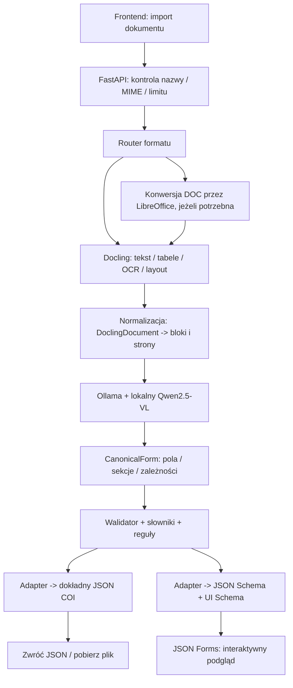

# FormFlow AI — plan realizacji projektu COI „Cyfryzacja formularzy”

> **AKTUALIZACJA DECYZJI (21.11.2026):** Ten dokument jest historycznym planem zakładającym lokalny model i brak zewnętrznych API. **Nie jest już obowiązującym planem runtime.** Dla HackNation zgłaszamy wariant **OpenRouter API / Qwen**, **bez** lokalnej inferencji. To **nie spełnia zakazu zewnętrznych API COI**. Aktualne priorytety w [TASKLIST.md](TASKLIST.md), pełna decyzja w [DECISION_API_SUBMISSION.md](DECISION_API_SUBMISSION.md). Punktów offline poniżej **nie realizujemy w tym hackathonie**.


> **HackNation 2026 · Plan wdrożeniowy / checklista**  
> **Stack:** [Docling](https://github.com/docling-project/docling) + [Ollama](https://github.com/ollama/ollama) / [Qwen2.5-VL](https://ollama.com/library/qwen2.5vl) + [JSON Forms](https://github.com/eclipsesource/jsonforms)  
> **Backend:** Python (preferowane przez COI: 3.14+) + FastAPI + Pydantic  
> **Frontend:** React + TypeScript + JSON Forms  
> **Uruchomienie:** Docker Compose, inferencja lokalna, bez wywołań zewnętrznych API podczas pracy aplikacji

## Status wdrożenia — 21 listopada 2026, 13:50

**Aktualna szczegółowa checklista:** [TASKLIST.md](TASKLIST.md) — ta sekcja zastępuje nieaktualny opis etapu 1.

| Obszar | Stan zweryfikowany |
|---|---|
| Docker/FastAPI/Tailscale | ✅ VPS, wersja 0.3.0, prywatny HTTPS :9466 |
| Git lokalny | ✅ `main`, ostatni commit przed aktualizacją `f22ab19` |
| GitHub | ✅ Prywatne [Tymidymi/formflow-ai](https://github.com/Tymidymi/formflow-ai), `origin/main` |
| OpenRouter / Qwen3-VL-8B | ✅ **Wyłącznie DEV:** przetestowana syntetyczna konwersja (HTTP 200) |
| Mapowanie JSON COI | 🟡 Prototyp, brak walidacji oficjalnym schematem i benchmarku na materiałach COI |
| Docling / stare DOC / ODS | ❌ Niezaimplementowane |
| JSON Forms / React | ❌ Niezaimplementowane |
| Konkursowy lokalny LLM | ❌ Niezaimplementowany; OpenRouter nie spełnia zakazu zewnętrznych API |
| Testy | ✅ 13/13 testów na wersji 0.3.0, bez benchmarków COI |

**Następna bramka MVP:** wpiąć oficjalny JSON Schema, naprawić eksport i testować rzeczywiste formularze COI.

---

## 1. Cel i kryteria sukcesu

**Cel:** urzędnik wgrywa istniejący blankiet formularza (PDF, DOC, DOCX, ODS, XLSX, JPG, JPEG, PNG), a system analizuje dokument i **zwraca JSON w dokładnym formacie wymaganym przez COI**, zgodny z zasadami budowy eUsług. Dodatkowo pokazuje podgląd formularza cyfrowego i umożliwia sprawdzenie pól.

**Nie mylić trzech formatów:**

1. `DoclingDocument` — struktura odczytana z pliku źródłowego.
2. `CanonicalForm` — nasza wewnętrzna, niezależna od COI reprezentacja pól i zależności.
3. `COI JSON` — **wymagany rezultat konkursu**; osobno generowane `JSON Schema + UI Schema` do renderowania w JSON Forms.

**Definition of Done — MVP (obowiązkowe):**

- [ ] `POST /api/v1/forms/convert` przyjmuje po jednym pliku we wszystkich wymaganych formatach i zwraca JSON zgodny z *rzeczywistym* wzorcowym schematem COI.
- [ ] Treść JSON odpowiada treści wgranego formularza, łącznie z logicznymi stronami/sekcjami.
- [ ] Działa niezależnie od zewnętrznych API, SaaS, MCP i chmurowych LLM.
- [ ] Waliduje rozszerzenie, faktyczny format/MIME, nazwę, rozmiar i zawartość pliku.
- [ ] Pliki wejściowe są przetwarzane tylko tymczasowo i usuwane po żądaniu.
- [ ] Projekt uruchamia się przez Docker, ma README i dokumentację architektury.
- [ ] Przechodzi test na co najmniej jednym **nowym, nieznanym wcześniej** formularzu.

**Definition of Done — wersja konkursowa:**

- [ ] Wykrywa walidacje pól (PESEL, telefon, e-mail, maksymalna długość itd.).
- [ ] Wykorzystuje słowniki i dane inicjalne COI; może zaproponować brakujący słownik.
- [ ] Wykrywa zależności warunkowe między polami, sekcjami i stronami.
- [ ] Ma frontend do importu, podglądu JSON-a i interaktywnego formularza.
- [ ] Ma gotowe wynikowe JSON-y, film ≤ 3 min, prezentację PDF ≤ 10 slajdów, repo i opis projektu.

## 2. Zasady i ograniczenia konkursowe

**Źródło:** „COI — Pełna treść zadania konkursowego.pdf”, sekcje 3–8.

| Obszar | Wymaganie | Realizacja |
|---|---|---|
| API | REST, upload **pojedynczego** pliku | FastAPI `multipart/form-data`, JSON w odpowiedzi |
| Wejście | `.pdf`, `.doc`, `.docx`, `.ods`, `.xlsx`, `.jpg`, `.jpeg`, `.png` | Adaptery Docling; obsługa `.doc` z LibreOffice (wymaga kontroli zależności/licencji) |
| Wynik | JSON gotowy do importu do COI | Adapter mapujący do wzorcowego schematu COI |
| Licencje | Open source bez copyleft wymuszającego publikację kodu, brak licencji komercyjnych | Audyt licencji kodu, modeli, OCR i zależności, `THIRD_PARTY_LICENSES.md` |
| Usługi | Bez zewnętrznych API/MCP/SaaS, bez LLM dostępnych wyłącznie przez API | Ollama **wewnątrz lokalnej sieci Dockera**; wagi modelu pobrane przed testem offline |
| Nazwa | Maks. 250 znaków, zakazane `; : > < / \ \| ' * % $` | Walidator uploadu, testy negatywne |
| Rozmiar | Konfigurowalne ograniczenie | `MAX_UPLOAD_MB` w konfiguracji |
| MIME | Rzeczywista zawartość zgodna z rozszerzeniem | Kontrola sygnatur/magic bytes + formatów kontenerowych; nie ufać nagłówkowi klienta |
| Pliki | Wyłącznie przetwarzanie tymczasowe | Pamięć/`TemporaryDirectory`, bez archiwizowania oryginałów, cleanup w `finally` |
| Docker | Oficjalne obrazy, przypięte tagi, bez `latest`, nie-root, minimalne porty, sekrety runtime | Dockerfile/Compose + testy bezpieczeństwa |
| Konfiguracja | Rozmiar pliku, parametry JWT, ewentualne parametry integracyjne | `.env.example` i klasa ustawień Pydantic |
| Ocena live | Nowe pliki podczas obrony | Testy generalizacji i tryb offline |

**Uwaga techniczna:** dokument podaje Python 3.14+ lub Java 21+ jako **preferowane**, nie jako bezwzględnie wymagane. Przed wyborem obrazu należy sprawdzić zgodność z Docling i bibliotekami OCR. Nie przeskakiwać na nieprzetestowaną wersję w dzień prezentacji.

## 3. Architektura



**Zasady projektowe:**

- Docling odczytuje dokument, Qwen **interpretuje znaczenie** — nie każemy modelowi samodzielnie czytać całego PDF-a od zera, jeśli treść została poprawnie wyciągnięta.
- Dla skanów lub skomplikowanego układu wysyłamy do modelu **render strony + tekst/OCR + strukturę tabel**.
- Qwen zwraca **ustrukturyzowany pośredni JSON**, nigdy bezpośrednio do UI bez walidacji.
- Każde pole ma identyfikator, źródłowy fragment/stronę (jeśli dostępny), typ, etykietę, opcje, reguły i poziom pewności.
- Nie dopisujemy pól na podstawie domysłów modelu; pola niepewne oznaczamy jako wymagające weryfikacji.
- **COI JSON nie musi odpowiadać JSON Schema.** Trzymamy dwa osobne adaptery wyjściowe.

## 4. Proponowana struktura monorepo

```text
formflow-ai/
├── apps/
│   ├── api/
│   │   ├── app/
│   │   │   ├── main.py
│   │   │   ├── api/routes/{convert,health,preview}.py
│   │   │   ├── core/{settings,security,errors}.py
│   │   │   ├── extraction/{router,docling_adapter,legacy_doc}.py
│   │   │   ├── ai/{ollama_client,prompts,extractor}.py
│   │   │   ├── domain/{canonical_form,validators,dictionaries}.py
│   │   │   ├── adapters/{coi_export,jsonforms_export}.py
│   │   │   └── services/pipeline.py
│   │   ├── tests/{unit,integration,fixtures}/
│   │   └── pyproject.toml
│   └── web/
│       ├── src/{components,pages,lib,types}/
│       ├── package.json
│       └── vite.config.ts
├── contracts/
│   ├── coi/              # schema i przykłady z materiałów COI
│   ├── canonical-form.schema.json
│   └── examples/
├── data/
│   ├── fixtures/         # tylko jawnie dozwolone pliki demonstracyjne
│   └── dictionaries/
├── docs/
│   ├── ARCHITECTURE.md
│   ├── API.md
│   ├── BENCHMARKS.md
│   └── DEMO_SCRIPT.md
├── docker/{api.Dockerfile,web.Dockerfile}/
├── docker-compose.yml
├── .env.example
├── .gitignore
├── THIRD_PARTY_LICENSES.md
└── README.md
```

## 5. Plan krok po kroku

> Czasy to orientacyjne **osobogodziny**, nie obietnica czasu wykonania. Przy pracy równoległej część etapów można realizować jednocześnie. Wszystkie kroki zamykamy testowalnym rezultatem.

### ETAP 0 — Zdobądź prawdziwe materiały COI (30–60 min) · P0

- [ ] Pobrać z Discorda `Cyfryzacja formularzy / materiały-dodatkowe`:
  - [ ] Przykładowe blankiety i odpowiadające im wzorcowe JSON-y.
  - [ ] Formularze konkursowe bez odpowiedzi (do wygenerowania).
  - [ ] Specyfikację konfiguracji formularzy i zasad projektowania eUsług.
  - [ ] Słowniki i dane inicjalne.
  - [ ] Ewentualne screeny eUsługi i instrukcje importu.
- [ ] Skatalogować pliki według formatu, liczby stron i trudności.
- [ ] Ustalić, co dokładnie oznacza "prawidłowy JSON" (klucze, typy, required, kolejność stron, enumy).
- [ ] Przygotować **test porównujący** wynik z JSON-em wzorcowym (struktura + zgodność semantyczna).
- [ ] Zapytać mentora COI, czy struktura musi być 1:1, oraz jak oceniane są różne poprawne podziały sekcji.

**Gotowe, gdy:** istnieje `contracts/coi/` z rzeczywistymi przykładami i można automatycznie wykryć niezgodność wyniku. **Bloker:** bez tych materiałów nie da się potwierdzić poprawności eksportu.

### ETAP 1 — Repozytorium, środowisko, licencje (45–75 min) · P0

- [ ] Utworzyć monorepo i katalogi jak powyżej.
- [ ] Dodać `.gitignore`, `.env.example`, podstawowy README, skrypt `make up/test` lub odpowiedniki.
- [ ] Zapiąć **konkretne wersje** Python, Docling, FastAPI, Ollama, Node, React, JSON Forms i bazowych obrazów.
- [ ] Zweryfikować licencje modelu i **całego** łańcucha zależności (w tym konwertera `.doc` i OCR).
- [ ] Upewnić się, że nie ma wywołań chmurowych; ustawić lokalne punkty API (localhost/Docker service names).
- [ ] Ustawić healthcheck dla API i Ollamy, limit zasobów, użytkownika nie-root.
- [ ] Zrobić pierwsze `docker compose up --build`.

**Gotowe, gdy:** czysty klon uruchamia API, web i Ollamę; licencje są udokumentowane.

### ETAP 2 — Spike: czy lokalny AI działa na naszym sprzęcie? (45–90 min) · P0

- [ ] Sprawdzić, czy maszyna demonstracyjna ma GPU i dość VRAM/RAM; **nie zakładać, że VPS ma GPU**.
- [ ] Pobrać i przetestować `qwen2.5vl:3b` w Ollamie; opcjonalnie `:7b` przy wystarczających zasobach.
- [ ] Wysłać prosty skan wniosku i kazać modelowi zwrócić strukturę dwóch pól jako JSON.
- [ ] Zmierzyć czas, pamięć, liczbę poprawnie rozpoznanych pól i stabilność.
- [ ] Przetestować model bez internetu **po wcześniejszym pobraniu wag**.
- [ ] W razie OOM zejść na mniejszy model/kwantyzację, zmniejszyć rozdzielczość obrazu i przetwarzać stronami.

**Gotowe, gdy:** lokalny model zwraca poprawny JSON w powtarzalny sposób, a demo działa na określonym sprzęcie.

### ETAP 3 — REST API i polityka uploadu (60–90 min) · P0

- [ ] Dodać `POST /api/v1/forms/convert` (`multipart/form-data`, pole `file`).
- [ ] Walidować dozwolone rozszerzenia, MIME i sygnaturę pliku; uwzględnić formaty Office oparte na ZIP.
- [ ] Blokować nazwy > 250 znaków i niedozwolone znaki `; : > < / \ | ' * % $`.
- [ ] Wprowadzić `MAX_UPLOAD_MB`, limity liczby stron/czasu przetwarzania i rozpakowania (zip bomb).
- [ ] Użyć bezpiecznej pamięci/przestrzeni tymczasowej z gwarantowanym sprzątaniem.
- [ ] Dodać przewidywalne odpowiedzi `400/413/415/422/500/503` i identyfikator żądania.
- [ ] Dodać `GET /healthz` i `GET /readyz`.
- [ ] Dodać konfigurację JWT (może być wyłączona wyłącznie na lokalnym demo; jeśli endpoint wystawiony, autoryzacja obowiązkowa).

**Przykładowy kontrakt (ostateczny format sukcesu zależy od COI):**

```http
POST /api/v1/forms/convert
Content-Type: multipart/form-data
file=@wniosek.pdf

200 OK
Content-Type: application/json

{ ... dokładny JSON COI ... }
```

**Gotowe, gdy:** testy API przechodzą dla wszystkich formatów i błędnych uploadów, nawet jeśli backend na razie zwraca przykładowy JSON.

### ETAP 4 — Docling: ekstrakcja dokumentów (90–150 min) · P0

- [ ] Implementować jedną usługę `extract(file) -> DocumentBlocks` na bazie Docling.
- [ ] PDF z warstwą tekstową → tekst, kolejność, tabele, nagłówki.
- [ ] Skan PDF i JPG/JPEG/PNG → lokalny OCR + podział na strony i współrzędne.
- [ ] DOCX/XLSX → bloki, arkusze, etykiety, pola tabelaryczne.
- [ ] ODS → sprawdzić natywny backend Docling na przykładach COI.
- [ ] DOC (format binarny) → adapter lokalnej konwersji przy użyciu LibreOffice, następnie Docling; sprawdzić licencję i bezpieczne uruchomienie konwertera bez makr.
- [ ] Zachować: `page`, `block_id`, `text`, `kind`, `table`, `bbox` (jeżeli dostępne), `source_type`.
- [ ] Dodać logikę fallback dla słabej ekstrakcji: rendering strony + Qwen VL.
- [ ] Zakazać uruchamiania makr / zdalnych odnośników oraz wyjścia poza katalog tymczasowy.

**Gotowe, gdy:** jeden spójny format pośredni działa dla każdego z 8 rozszerzeń (7 kategorii), w tym dokumentu zeskanowanego.

### ETAP 5 — CanonicalForm: wewnętrzny model semantyczny (45–75 min) · P0

- [ ] Zdefiniować modele Pydantic `Form`, `Page`, `Section`, `Field`, `Option`, `Validation`, `Dependency`.
- [ ] Typy pól: text, textarea, number, date, checkbox, radio, select, address, file, email, phone itd.
- [ ] Obsłużyć nazwy/etykiety, opisy, required, domyślne wartości, zakresy, wzorce, opcje.
- [ ] Przechowywać odniesienie do źródła (`source_page`, `source_block_id`, `source_snippet`) i flagi niepewności.
- [ ] Dodać JSON Schema opisujący **nasz** model, odrębny od COI.
- [ ] Przygotować 2–3 ręcznie opracowane `CanonicalForm` z materiałów COI jako fixture.

**Gotowe, gdy:** model opisze przykładowy formularz bez utraty obowiązkowych elementów.

### ETAP 6 — Pipeline Docling → Ollama/Qwen → CanonicalForm (120–180 min) · P0

- [ ] Przygotować prompt systemowy po polsku z jasnym zadaniem, listą typów i zakazem halucynowania pól.
- [ ] Wejście: ujednolicone bloki Docling + (opcjonalnie) obrazy wybranych stron.
- [ ] Wyjście: **JSON zgodny z Pydantic**; użyć structured output/JSON mode, jeśli obsługiwany przez zapiętą wersję Ollama/modelu.
- [ ] Przetwarzać długie dokumenty **stronami/sekcjami** z późniejszym łączeniem oraz deduplikacją.
- [ ] Rozpoznać strony tematyczne, pytania, pola, zaznaczanie opcji, wymagane załączniki.
- [ ] Rozpoznać istotne warunki („jeśli”, „w przypadku”, „zaznaczyć odpowiednie”) i walidacje.
- [ ] Po inferencji: normalizacja ID, kontrola referencji, walidacja struktury, maks. 1–2 próby naprawy.
- [ ] Logować **metryki, bez danych osobowych ani treści dokumentów**.
- [ ] Jeśli nie da się bezpiecznie określić pola, oznaczyć `needs_review` zamiast je wymyślać.

**Gotowe, gdy:** dwa różne przykładowe formularze automatycznie przechodzą do `CanonicalForm` z poprawnymi typami i sekcjami.

### ETAP 7 — Najważniejsze: eksport do JSON COI (90–150 min) · P0

- [ ] Napisać `CanonicalForm -> COI JSON`, wyłącznie na podstawie **faktycznych** wzorców i specyfikacji od COI.
- [ ] Mapować dokładnie identyfikatory, typy, strony, sekcje, komponenty, właściwości, słowniki i zależności.
- [ ] Dodać walidator wyjściowego JSON-a (JSON Schema lub walidacja własna zgodna z dokumentacją COI).
- [ ] Dodać deterministyczne ID i stabilną kolejność elementów.
- [ ] Porównać referencyjne wyniki zarówno strukturalnie, jak i semantycznie (bez wymagania identycznego formatowania tekstu).
- [ ] Dodać automatyczne zgłaszanie brakujących wymaganych pól/zależności.
- [ ] Wystawić JSON jako **bezpośrednią odpowiedź endpointu konkursowego**.

**Gotowe, gdy:** JSON importuje się w docelowym formacie lub przechodzi weryfikację COI bez ręcznych przeróbek. **To główny punkt kontrolny projektu.**

### ETAP 8 — Reguły, walidacje i słowniki (90–150 min) · P1

- [ ] Mapować słowniki z materiałów COI do odpowiednich pól (np. województwo, forma odpowiedzi, rodzaj sprawy).
- [ ] Dodać domyślne wartości/dane inicjalne, gdy mają sens w świetle specyfikacji.
- [ ] Zaproponować nowy słownik wyłącznie gdy brak go w danych źródłowych i zachodzi realna potrzeba.
- [ ] Rozpoznawać reguły widoczności, wymagania lub aktywacji pola/sekcji/strony zależnie od odpowiedzi użytkownika.
- [ ] Walidować PESEL (format + suma kontrolna), e-mail, telefon, NIP, REGON (jeśli obecne), daty, długości i zakresy.
- [ ] Oddzielić reguły wyczytane z dokumentu od bezpiecznych sugestii, które wymagają akceptacji urzędnika.
- [ ] Testy: zależność „osoba fizyczna vs firma”, „tak → pokaż dane załącznika”.

**Gotowe, gdy:** na co najmniej jednym formularzu widać działający słownik, poprawną walidację i warunkowe pole.

### ETAP 9 — Frontend i JSON Forms (120–180 min) · P1

- [ ] Zbudować ekran główny z drag & drop, wyborem pliku, czytelnym komunikatem o ograniczeniach.
- [ ] Wyświetlić postęp: walidacja → ekstrakcja → AI → JSON (dla synchronicznego API jako statusy w UI, bez udawania prawdziwego streamingu).
- [ ] Po przetworzeniu: 3 zakładki **Oryginał / JSON COI / Formularz cyfrowy**.
- [ ] Zrobić adapter `CanonicalForm -> JSON Schema + UI Schema` dla JSON Forms.
- [ ] Dodać układ stron tematycznych jako kroki (wizard) nad JSON Forms; samego renderera nie traktować jako automatycznego odpowiednika COI.
- [ ] Dodać podstawowe komponenty dla dat, wyborów, pól tekstowych, checkboxów i komunikatów błędów.
- [ ] Za pomocą JSON Forms odzwierciedlać zależności warunkowe oraz walidacje, w zakresie obsługiwanym przez bibliotekę.
- [ ] Dodać przycisk **Pobierz JSON COI** oraz widok `needs_review`.
- [ ] Responsywność i czytelne stany błędów.

**Gotowe, gdy:** użytkownik może wgrać plik, zobaczyć poprawny JSON i faktycznie wypełnić jego interaktywną reprezentację.

### ETAP 10 — Testy jakości i bezpieczeństwa (90–150 min) · P0

**Testy obowiązkowe:**

- [ ] Każde rozszerzenie: `.pdf`, `.doc`, `.docx`, `.ods`, `.xlsx`, `.jpg`, `.jpeg`, `.png`.
- [ ] PDF z tekstem oraz skan PDF bez tekstu.
- [ ] Formularz z tabelą, checkboxami, sekcjami i logiką warunkową.
- [ ] Fałszywe rozszerzenie, zły MIME, plik uszkodzony, plik powyżej limitu.
- [ ] Nazwa o 251 znakach oraz nazwy z każdym znakiem zabronionym.
- [ ] Ochrona przed ZIP bomb, nadmiernym liczbą stron, makrami i próbami połączeń sieciowych z parsowanych dokumentów.
- [ ] Brak pozostałości dokumentów po sukcesie, błędzie i timeout.
- [ ] Niedostępny Ollama → kontrolowany `503`, bez zawieszenia API.
- [ ] Pełny test `docker compose up --build` na **czystym środowisku**.
- [ ] Test offline po preinstalacji wag: brak DNS/internetu, nadal działa konwersja.
- [ ] Test na **formularzu spoza zbioru rozwojowego** (symulacja live jury).

**Metryki do raportu:**

- Zgodność syntaktyczna JSON i ze schematem COI (%).
- Pokrycie pól względem wzorca / testu ręcznego (%).
- Poprawność typów i `required` (%).
- Poprawność podziału na strony/sekcje i zależności.
- Czas mediany i p95 konwersji oraz wykorzystanie RAM/VRAM.
- Odsetek przypadków kierowanych do weryfikacji przez urzędnika.

**Gotowe, gdy:** wynik nie zależy od jednego wytrenowanego formularza, a demonstracja jest powtarzalna.

### ETAP 11 — Dopracowanie pod jury (45–90 min) · P1

- [ ] Pokaż różnicę „papierowy dokument → gotowa eUsługa” na jednym najlepiej przygotowanym przykładzie.
- [ ] Zaprezentuj przynajmniej jedną logikę warunkową i walidację PESEL/telefonu.
- [ ] Pokaż, skąd wzięło się pole (fragment oryginalnego dokumentu + status pewności/oceny).
- [ ] Pokaż 2–3 różne formaty na żywo: PDF, Word/Excel, skan.
- [ ] Dodaj krótki ekran z korzyściami: prywatność, koszt lokalnej inferencji, brak abonamentu za API.
- [ ] Zademonstruj przejście „nowy dokument od jury → JSON COI”, zamiast jedynie odtwarzać gotowe pliki.

**Gotowe, gdy:** osoba nieznająca projektu rozumie jego działanie po 30 sekundach.

### ETAP 12 — Pakiet konkursowy (90–150 min) · P0

- [ ] Uzupełnić README: build Docker, start, konfiguracja, wymagania sprzętowe, curl, formaty, ograniczenia.
- [ ] Napisać `docs/ARCHITECTURE.md`: diagram, przepływ danych, lokalne AI, bezpieczeństwo i formaty wyjścia.
- [ ] Zapisać **wszystkie wymagane wynikowe JSON-y** do `outputs/`.
- [ ] Dodać `THIRD_PARTY_LICENSES.md`, wskazówki dot. wag modelu i reprodukowalnego pobierania.
- [ ] Nagrać demo **≤ 3 min** i udostępnić przez link w dostępnym, otwartym repozytorium (sprawdzić odtwarzanie incognito).
- [ ] Przygotować PDF **≤ 10 slajdów** (problem, rozwiązanie, demo, architektura, jakość, bezpieczeństwo, koszty, wdrożenie).
- [ ] Dodać tytuł i szczegółowy opis projektu, repo kodu i — jeśli dostępny — link do demo.
- [ ] Wykonać próbę całego procesu z czystego checkoutu oraz z formularzem nieznanym zespołowi.
- [ ] Zweryfikować finalną listę submission i deadline na Discordzie/stronie organizatora.

**Gotowe, gdy:** wszystkie wymagane materiały są dostępne z jednej strony repo i nikt nie musi dopowiadać, jak uruchomić system.

## 6. Priorytety i kolejność „critical path”

| Kolejność | Etap | Priorytet | Efekt |
|---:|---|---|---|
| 1 | Materiały i schemat COI | P0 | Wiadomo, co musi wyjść |
| 2 | Repo/Docker, test Ollama | P0 | Wiadomo, że stack działa |
| 3 | Upload API i Docling | P0 | Wczytanie wymaganych formatów |
| 4 | `CanonicalForm` i Qwen | P0 | Automatyczna analiza |
| 5 | Adapter JSON COI | **P0 — bramka MVP** | Pierwszy poprawny eksport |
| 6 | Testy wszystkich formatów / offline | P0 | Wiarygodne rozwiązanie |
| 7 | Słowniki, zależności, walidacje | P1 | Dodatkowe punkty |
| 8 | JSON Forms / frontend | P1 | Demo dla jury |
| 9 | README, PDF, film, wyniki | **P0 — submission** | Projekt możliwy do oceny |

**Zasada:** jeżeli brakuje czasu, priorytetem jest **poprawny COI JSON + wszystkie wejściowe formaty + Docker + dokumentacja + submission**. Nie oddawać świetnego frontendu z niepoprawnym JSON-em.

## 7. Równoległa praca (opcjonalnie, 3 osoby)

| Osoba | Główna odpowiedzialność | Integracje |
|---|---|---|
| A — backend | FastAPI, MIME, Docling, Docker, bezpieczeństwo | `DocumentBlocks` |
| B — AI / schema | Qwen, `CanonicalForm`, walidacja, eksport COI | `CanonicalForm` i `COI JSON` |
| C — frontend / demo | React, JSON Forms, UX, prezentacja, nagranie | `JSON Schema + UI Schema` |

**Wspólna pierwsza czynność:** zatwierdzić kontrakt `CanonicalForm` i rzeczywistą specyfikację COI. Bez tego praca równoległa wprowadzi niespójności.

## 8. Plan testów akceptacyjnych (przykłady)

| ID | Wejście / sytuacja | Oczekiwany wynik |
|---|---|---|
| T01 | PDF tekstowy | Odczyt treści, poprawny JSON COI |
| T02 | PDF zeskanowany | OCR, poprawny JSON lub zaznaczenie wątpliwych pól |
| T03 | DOC starego typu | Lokalna konwersja, poprawny JSON |
| T04 | DOCX z tabelą | Odtworzenie etykiet i typów pól |
| T05 | ODS z kilkoma arkuszami | Zachowanie istotnych tabel i etykiet |
| T06 | XLSX | Rozpoznanie danych formularza, nie „zwykłych danych arkusza” |
| T07 | JPG / JPEG / PNG | OCR + interpretacja układu |
| T08 | Zła nazwa / fałszywy MIME | Odpowiedź 4xx, plik odrzucony |
| T09 | Plik nad limit | 413, bez uruchamiania modelu |
| T10 | Dokument wielostronicowy | Zachowana logiczna kolejność stron i sekcji |
| T11 | Zależność „tak/nie” | Pole/sekcja zmienia widoczność w podglądzie |
| T12 | Błędny PESEL | Błąd walidacji w podglądzie |
| T13 | Brak internetu | Wszystkie komponenty działają po zainstalowaniu wag |
| T14 | Nowy plik od jury | Proces działa bez zmian kodu i promptów |
| T15 | Wyjątek podczas OCR/AI | Poprawny błąd, cleanup pliku tymczasowego |

## 9. Ryzyka i plan awaryjny

| Ryzyko | Sygnał | Plan B |
|---|---|---|
| Brak wzorców COI | Nie da się zwalidować eksportu | Pilnie pobrać materiały/mentor; do tego czasu tylko model pośredni |
| Qwen 7B nie mieści się w VRAM | OOM, timeout | `qwen2.5vl:3b`, kwantyzacja, obraz po obrazie, krótszy kontekst |
| VPS jest CPU-only | Wielominutowa inferencja | Jednomaszynowe demo na komputerze z GPU; **bez zewnętrznej usługi inferencji** |
| Słaby OCR | Puste/poszarpane pola | Rendering wysokiej jakości + model vision, oznaczanie do weryfikacji |
| `.doc` wymaga konwersji | Docling nie czyta starszego DOC bez LibreOffice | Dedykowany adapter lokalny i testy licencji/izolacji |
| Model tworzy niepoprawny JSON | Błąd schematu | Structured output, Pydantic, kontrolowany retry; bez ręcznego fałszowania wyniku |
| COI JSON jest bardzo złożony | Dużo kluczy/relacji | Adapter deterministyczny i iteracja wg wzorców zamiast „LLM pisze format” |
| Prezentacja bez internetu | Model próbuje pobierać wagi | Preload i `docker compose` testowany offline |
| Brak czasu | Dużo funkcji dodatkowych | Ograniczyć frontend i batch; nie ograniczać obowiązkowego API/eksportu |
| Niejasne licencje komponentów | Trudno wykazać zgodność | Audyt zależności, wersji i wag; zamiana problematycznych komponentów |

## 10. Zarys demonstracji (film maks. 3 min)

1. **0:00–0:20** — Problem: ręczne przekształcanie papierowych wniosków jest czasochłonne.
2. **0:20–0:45** — Drag & drop autentycznego formularza (np. skan lub DOCX).
3. **0:45–1:25** — Docling + lokalny Qwen; pokaz wygenerowanego **COI JSON**.
4. **1:25–2:05** — Ten sam wniosek jako klikalny formularz JSON Forms, walidacja i warunkowe sekcje.
5. **2:05–2:35** — Nowy typ dokumentu, wsparcie wielu formatów i przejście przez API.
6. **2:35–3:00** — Architektura lokalna, bezpieczeństwo danych, brak kosztów za API i gotowość do wdrożenia.

## 11. Prezentacja PDF (do 10 slajdów)

1. **FormFlow AI** — nazwa, slogan i jednozdaniowy opis.
2. Problem urzędów i proces obecny.
3. Nowy workflow: plik → AI → JSON COI → eUsługa.
4. Zrzuty realnej konwersji na danych COI.
5. Architektura Docling + Ollama/Qwen2.5-VL + JSON Forms.
6. Rozpoznawanie pól, walidacje, zależności i słowniki.
7. Jakość: testy na nieznanych dokumentach i wynik benchmarku.
8. Bezpieczeństwo: offline, tymczasowe pliki, licencje, Docker.
9. Koszt i potencjał wdrożeniowy (wskazać wyłącznie **zmierzone** parametry sprzętowe i czasy).
10. Zespół, link do repo, demo, dalszy rozwój.

## 12. Checklista ostatecznego oddania

- [ ] Nazwa i szczegółowy opis projektu.
- [ ] Repozytorium z kodem, Dockerem i plikiem README.
- [ ] API REST przetwarza jeden plik i zwraca JSON COI.
- [ ] Wynikowe pliki JSON wygenerowane dla materiałów konkursowych.
- [ ] Prezentacja PDF — maksymalnie 10 slajdów.
- [ ] Film — maksymalnie 3 minuty, link w dostępnym otwartym repozytorium.
- [ ] Dodatkowo: screeny, link do demo i opis architektury.
- [ ] Test live na nieznanym pliku, offline i na czystej instalacji.
- [ ] Audyt licencji i brak zewnętrznych usług API w runtime.
- [ ] Nie ma w repo wrażliwych danych, tokenów ani przypadkowych uploadów.

## 13. Kryteria jury i na czym zdobywamy punkty

| Kryterium | Waga | Konkretna odpowiedź projektu |
|---|---:|---|
| Kompletność | **30%** | Wszystkie wymagane formaty i JSON COI + słowniki, zależności, frontend, walidacje |
| Intuicyjność | **20%** | Import w jednym kroku, czytelne błędy, podgląd źródła i eUsługi |
| Oryginalność | **10%** | Wskazanie źródła pól i niepewności AI, pomoc przy kontroli urzędnika |
| Jakość kodu | **20%** | Moduły, kontrakty Pydantic, testy, izolowany Docker, CI |
| Potencjał wdrożeniowy | **20%** | Bez zewnętrznych API, lokalne przetwarzanie, kontrola danych i kosztów |

**Uwagi:** Oryginalne kryteria zawarte są w sekcji 8 pełnej treści zadania COI. Regulamin przewiduje jedną nagrodę główną 25 000 zł brutto pomniejszaną o podatek oraz obowiązek podpisania umowy przeniesienia praw autorskich przez zwycięzców. Nie dodawać do repo niezweryfikowanych licencyjnie materiałów ani plików nieprzeznaczonych do publikacji.

## 14. Przydatne źródła techniczne

- [Docling — repozytorium](https://github.com/docling-project/docling) i [obsługiwane formaty](https://docling-project.github.io/docling/usage/supported_formats/): `.ods` obsługiwany; `.doc` wymaga instalacji LibreOffice.
- [Ollama — repozytorium](https://github.com/ollama/ollama) i [Qwen2.5-VL — modele](https://ollama.com/library/qwen2.5vl).
- [Qwen2.5-VL-7B — karta modelu i licencja](https://huggingface.co/Qwen/Qwen2.5-VL-7B-Instruct).
- [JSON Forms — repozytorium](https://github.com/eclipsesource/jsonforms), [UI Schema](https://jsonforms.io/docs/uischema/), [reguły](https://jsonforms.io/docs/uischema/rules/), [walidacja](https://jsonforms.io/docs/validation/).
- Materiały bazowe: `COI - Pełna treść zadania konkursowego.pdf` i `COI - Regulamin zadania konkursowego.pdf`.
- **Niezbędne brakujące materiały:** pliki przykładowe, wzorcowe JSON-y, dokładna specyfikacja formatu i słowniki z Discorda COI.

---

**Najbliższy krok do realizacji:** ETAP 0 — pobrać wzorcowy JSON i opis struktury COI, a następnie na jednym formularzu zbudować dowód działania: `Docling → Qwen → CanonicalForm → COI JSON`. Do czasu przejścia tego testu nie rozszerzać frontendu.